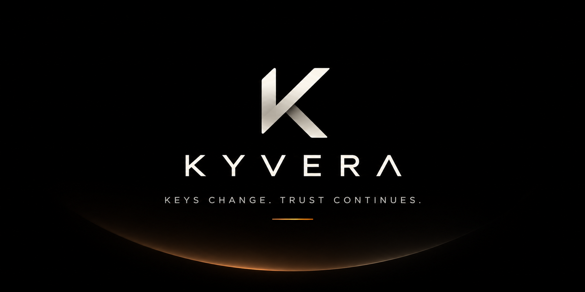
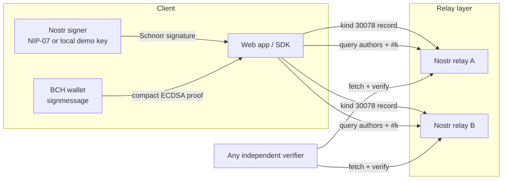

# KYVERA



**The Identity Continuity Protocol**
**Keys change. Trust shouldn't disappear.**

KYVERA is an open-source decentralized identity lifecycle protocol connecting Bitcoin Cash wallets with Nostr identities. It is a BCH Blaze 2026 submission for the Paytaca Decentralized Identity bounty.

**Live:** https://kyvera-alpha.vercel.app · **Watch the narrated films:** https://kyvera-alpha.vercel.app/tutorial · **Submission package:** [`docs/SUBMISSION_PACKAGE.md`](docs/SUBMISSION_PACKAGE.md)

The project answers a question that existing BCH↔Nostr bindings do not:

> After a wallet is rotated, revoked or compromised, how can an independent verifier determine which identity binding is authorized **now**?

A historical signature can remain cryptographically valid forever. Validity is not authorization. KYVERA separates the two.

---

## 1. What KYVERA is

A KYVERA identity is a Nostr key plus a sequence of signed, hash-linked authorization records:

- **Nostr key** — the durable identity handle. Its Schnorr signature authenticates every record.
- **BCH wallet** — the current payment identity. Its `signmessage` compact ECDSA signature proves control of the address.
- **Lifecycle chain** — `bind` at sequence 0, then `rotate` / `revoke` transitions. Each record commits to the previous record's digest.

A verifier resolves one of eight explicit outcomes:

| Status | Meaning |
| --- | --- |
| `ACTIVE` | Valid chain, current authorization, not revoked or expired. |
| `SUPERSEDED` | A real historical binding that has been rotated away from. |
| `REVOKED` | Explicitly revoked by the currently authorized keys. |
| `EXPIRED` | The current binding outlived its `expiresAt`. |
| `CONFLICT` | The identity key published competing records, or a fork exists. |
| `STALE` | The chain is incomplete or no relay could be reached. |
| `UNKNOWN` | No KYVERA records exist for the subject. |
| `INVALID` | Proofs, encoding or transitions failed verification. |

`ACTIVE` is never returned when the verifier cannot establish a sufficiently fresh state. Uncertainty is a first-class result, not an error message.

## 2. The problem

Existing bindings (including the closest public implementation, [`nostr-bch-bind`](https://gist.github.com/apeirs/aff6b63931c57e1a0729a72770abb325)) prove that two keys were associated once. They generally:

- select the newest valid event by `created_at`, without a hash-linked chain;
- have no notion of rotation (a new BCH address is just a new binding);
- allow revocation authorized by the Nostr key alone;
- cannot distinguish a stale relay from a quiet identity;
- do not define challenge-response authentication for relying applications.

KYVERA treats identity as a state machine with authorization rules, not as a directory of signatures. See [`docs/COMPETITIVE_AUDIT_2026.md`](docs/COMPETITIVE_AUDIT_2026.md) for source-level evidence on Kola Link, CashLink ID, BCH Identity Bridge and prior art, and [`docs/FINAL_COMPETITIVE_AUDIT.md`](docs/FINAL_COMPETITIVE_AUDIT.md) for the submission-readiness assessment.

## 2.1 What is new in this iteration

- **Trust Challenge** (`/challenge`): five executable stages — Bind, Verify, Authenticate, Rotate, Prove — in a deterministic guided demo or against a live stored identity. The final stage shows a historically valid wallet that is no longer authorized.
- **Merchant example** (`/merchant`): a self-asserted demo merchant whose payment destination unlocks only after verification, then moves to the new wallet after an authorized rotation.
- **Standalone relying party** (`pnpm rp:demo`): a framework-independent Node app that authenticates, rejects replay and verifies rotation/revocation without the KYVERA website, API or relay.
- **Identity Time Machine** (`/demo` and every identity dashboard): inspect each signed record, its predecessor digest, both proofs, relay observations and the explanation for acceptance or rejection.
- **Security laboratory** (`/lab`): six executable adversarial scenarios — authorized rotation, unauthorized rotation, replay, equivocation, missing history/rollback, revocation — using real verifier functions and deterministic unspendable keys.
- **Guided 90-second demo** (`/demo`): the full argument in eight steps, with no wallet or relay required.
- **Standalone HTML demo** (`demo/kyvera-standalone.html`): the real verifier bundled into one file for judges who cannot install dependencies.
- **Wallet probe** (`/interop`): test a real Electron Cash / Cashonize / Paytaca `signmessage` signature and record the actual result. No compatibility is claimed until a real row exists.
- **KYVERA Pay** (`/pay`): resolve an identity, enforce ACTIVE/network/freshness policy, re-resolve before handoff, and generate a BIP21/QR payment for Paytaca, Selene, Cashonize or Electron Cash. WizardConnect pairing is implemented for Paytaca and Cashonize.
- **Independent relying-party auth** (`/auth-demo`): origin/session/identity/address-bound single-use challenges, short-lived sessions, replay/expiry rejection, logout and revocation/rotation invalidation.
- **Automatic wallet connection** (`/create`): Create Identity defaults to Connect Wallet and exposes Connect → Sign → Verified → Publish states. WizardConnect retrieves the BCH address automatically; the wallet signs the proof message and KYVERA verifies the pasted signature immediately, enabling publishing only after it matches. WizardConnect does not expose arbitrary message signing, so this remains an explicit two-step proof. Not yet tested with a physical wallet.
- **Glass design system**: translucent navigation/summary surfaces, warm-light theme, reduced-motion support, and a single dark/light token set.
- **Identity Time Machine 3.0**: Compare mode separates historical proof validity from current authorization; proof inspection remains per-record.
- **Security laboratory 3.0**: split view, transition strip, replay/reset controls, real verifier output.
- **Editorial design system** (`docs/DESIGN_SYSTEM.md`): charcoal, ivory, signal orange, muted mint; accessible interaction states and reduced-motion support.
- **Property-based and malformed-input testing** for canonical JSON and authorization-chain parsing.
- **Security challenge suite**: explicit adversarial tests for forged proofs, unauthorized rotation, replay, expiry, revocation, missing history, conflicts, rollback and payment gating.

## 3. Architecture

```text
apps/web/                 Next.js App Router UI (create, dashboard, verify, auth)
packages/core/            Canonical JSON, record model, chain state machine
packages/bch/             CashAddr handling, wallet signmessage signing/verification
packages/nostr/           NIP-78 event encoding, relay queries, publishing
packages/verifier/        Independent verifier, lifecycle SDK, challenge service, CLI
examples/                 Executable node verifier and lifecycle demonstration
demo/                     Single-file standalone browser demonstration
tests/                    Unit, security, property and relay integration tests, vectors
scripts/                  Local demo relay, vector generator, browser QA, standalone builder
docs/                     Protocol, threat model, requirements, competitor and security reports
```



No server sits in the verification path. The web application is a client of the same SDK that third parties use.

## 4. Protocol summary

- **Record publication:** NIP-78 event, kind `30078`, authored by the identity's Nostr key.
- **Canonical encoding:** KCJ-1 — sorted keys, no whitespace, NFC strings, safe integers only. Non-canonical content is rejected.
- **BCH proof:** `signmessage`-compatible compact recoverable ECDSA over a domain-separated message:
  ```text
  KYVERA/v1/bch-proof
  role:new|current
  address:<cashaddr>
  record:<sha256 of canonical payload>
  ```
  The public key is recovered from the signature; the address is its `hash160`. The key is never supplied by the claimant.
- **Nostr proof:** BIP-340 Schnorr signature over the event (the standard NIP-01 event id).
- **Chain link:** `previous = sha256(canonical previous signed record)`.
- **Authorization policy:**
  - `bind` — new BCH key + Nostr key
  - `rotate` — current BCH key + new BCH key + Nostr key
  - `revoke` — current BCH key + Nostr key; no transition may follow
- **Distinct keys:** a BCH public key whose x-only coordinate equals the Nostr key is rejected (`KEY_REUSE`).

Full byte-level rules, tag layout and state-transition algorithm: [`docs/PROTOCOL.md`](docs/PROTOCOL.md).

## 5. Supported signing formats

| Side | Format | Status |
| --- | --- | --- |
| Nostr | NIP-01 BIP-340 Schnorr event signature | Implemented and tested |
| Nostr | NIP-07 browser extension (`window.nostr.signEvent`) | Implemented in the web app |
| Nostr | Local demo key in the browser | Implemented, clearly labelled demo-only |
| Nostr | NIP-42-shaped kind `22242` challenge authentication | Implemented and tested |
| BCH | Wallet `signmessage` compact recoverable ECDSA (65 bytes, base64) | Implemented and tested |
| BCH | WizardConnect wallet: address retrieved automatically; `signmessage` pasted and independently verified | Implemented in the create flow |
| BCH | In-browser demo wallet | Implemented, clearly labelled demo-only |
| BCH | Multisig, P2SH, hardware-wallet PSBT flows | Not supported in v1 |

The wallet `signmessage` convention is the one used by Electron Cash, Cashonize and Paytaca (`hash256("\x18Bitcoin Signed Message:\n" + compactSize(len) + message)`). An independent signature from the `nostr-bch-bind` test vectors is verified in [`tests/interop.test.ts`](tests/interop.test.ts). A live test against a funded wallet was **not** performed in this workspace; see [remaining work](#15-repository-status-and-remaining-work).

## 6. Installation

Requirements: Node.js 20+, a package manager. The repository is configured for pnpm 9.

```bash
# If pnpm is not installed globally:
npm install -g pnpm@9.15.9
# or run every command through: npx pnpm@9.15.9 <command>

pnpm install
pnpm build          # builds packages, then the web app
```

Copy `apps/web/.env.example` to `apps/web/.env.local` for the web app, and adjust:

```bash
NEXT_PUBLIC_KYVERA_RELAYS=ws://127.0.0.1:7777
NEXT_PUBLIC_KYVERA_NETWORK=mainnet
NEXT_PUBLIC_KYVERA_DOMAIN=kyvera.local
```

The default is the local demo relay only. Add public relays (for example `wss://relay.damus.io`) when you intend to query and publish on the public network. The root `.env.example` documents the same values for reference; CLI users can set `KYVERA_RELAYS` in their shell.

## 7. Running locally

```bash
# terminal 1 — local Nostr relay (persists to .context/relay-events.json)
pnpm relay

# terminal 2 — web application at http://localhost:3000
pnpm dev

# terminal 3 — optional: seed a complete bind → rotate identity
pnpm demo

# no install required for the standalone demonstration
open demo/kyvera-standalone.html
```

`pnpm relay` is a demo relay only: NIP-01 EVENT/REQ/CLOSE, signature checking, in-memory store with a JSON snapshot. It has no auth, rate limits or NIP-11 document.

## 8. Running tests

```bash
pnpm test           # 136 tests across 13 files (unit, integration, security, property)
pnpm typecheck      # strict TypeScript for every package
pnpm build          # production build
pnpm demo:lifecycle # executable lifecycle demo with assertions
pnpm qa:browser     # Playwright: desktop, mobile, reduced motion, keyboard
pnpm rp:demo        # independent relying party: 10/10 checks
pnpm relay:health   # read-only production relay EOSE check
BASE=https://your-deployment pnpm smoke:deploy  # post-deployment smoke test
pnpm demo:standalone# rebuild the single-file browser demo
```

Deterministic vectors live in [`tests/fixtures/vectors.json`](tests/fixtures/vectors.json) and are reproducible:

```bash
pnpm vectors
```

## 9. Verifying an identity independently

### CLI

```bash
pnpm cli npub1… --relay wss://relay.damus.io --relay wss://nos.lol
pnpm cli --address bitcoincash:q… --relay wss://nos.lol
pnpm cli --file events.json
```

Exit code `0` means a conclusive lifecycle state (`ACTIVE`, `SUPERSEDED`, `REVOKED`, `EXPIRED`). Exit code `1` means uncertain or invalid (`STALE`, `CONFLICT`, `UNKNOWN`, `INVALID`). `--json` emits the complete machine-readable resolution.

### SDK

```ts
import { resolveIdentity } from "@kyvera/verifier";

const result = await resolveIdentity({
  subject: "64-char-hex-nostr-public-key",
  relays: ["wss://relay.damus.io", "wss://nos.lol"],
});

if (result.status === "ACTIVE") {
  // result.activeBch.address is the currently authorized destination
}
```

Offline verification of an event set:

```ts
import { resolveEvents } from "@kyvera/verifier";
const { resolution } = resolveEvents(events, { now: Math.floor(Date.now() / 1000) });
```

No API key, hosted service or KYVERA backend is involved.

## 10. Performing a rotation

In the demo dashboard, **Prepare rotation → Rotate now** generates a new BCH keypair and publishes a sequence N+1 record signed by:

1. the current BCH private key (authorizes leaving),
2. the new BCH private key (proves control of the destination),
3. the Nostr identity key (binds the transition to the identity).

Programmatically:

```ts
import { createRotateRecord, previousStateFrom } from "@kyvera/verifier";

const rotation = await createRotateRecord({
  signer,                                  // current Nostr signer
  previous: previousStateFrom(headRecord), // current head
  currentBchPrivateKey: oldWallet,
  newBchPrivateKey: newWallet,
  newBch: newBchIdentity,
});
```

A rotation signed without any one of those three keys is rejected. Losing the current BCH key blocks rotation; there is no hidden recovery shortcut.

## 11. Demonstration steps

The fastest path for a judge is the single-file demo: open `demo/kyvera-standalone.html`. It runs the real verifier with deterministic fixtures and needs no install.

For the full application:

1. Start `pnpm relay` and `pnpm dev`.
2. Open `http://localhost:3000/challenge` for the five-stage Trust Challenge, `http://localhost:3000/demo` for the guided eight-step demonstration, or `/create` to make a real browser-local identity.
3. Generate a demo Nostr key and a demo BCH wallet (or connect NIP-07 and sign with an external wallet).
4. Inspect the exact BCH proof message and canonical Nostr content.
5. Publish. Open the identity dashboard and use the **Identity Time Machine** to inspect record digests, both proofs and relay observations.
6. Rotate to a new wallet. Confirm the old address becomes `SUPERSEDED`.
7. Verify the same npub in the public verifier and from the CLI.
8. Open `/pay?npub=…` to resolve the current destination and prepare a BIP21 wallet handoff. It blocks revoked/conflicted/stale identities and never invents a receipt.
9. Revoke the identity. Confirm the verifier returns `REVOKED` and no payment address.
10. Run `/lab` for the six adversarial scenarios, `/merchant` for the rotation-aware payment destination, and `pnpm rp:demo` for the standalone relying party.
11. Run `pnpm demo:lifecycle` for the terminal lifecycle version.

Do not fund any demo address. Demo keys are throwaway material stored in browser localStorage.

The 90-second script and recording guidance are in [`docs/DEMO.md`](docs/DEMO.md).

## 12. Security assumptions

- The Nostr identity key is controlled only by the identity owner.
- The current BCH wallet key is controlled by the identity owner.
- Relays are untrusted transport. They may omit, reorder or equivocate; they cannot forge signatures.
- The verifier's clock is approximately correct; records issued more than 10 minutes in the future are rejected.
- Off-chain protocols cannot prove completeness of history. `STALE` communicates missing history; optional checkpoints detect known rollbacks.
- Browser localStorage is not a secure keystore. It is used only for the explicitly labelled demo signer.

See [`docs/THREAT_MODEL.md`](docs/THREAT_MODEL.md) and [`docs/SECURITY_LIMITATIONS.md`](docs/SECURITY_LIMITATIONS.md).

## 13. Known limitations

- **No recovery.** Losing both the current BCH key and the Nostr key means the identity cannot be advanced or revoked. This is documented policy, not an accidental shortcut.
- **Rollback resistance is not absolute.** A relay set that withholds newer history cannot be detected without an external checkpoint. The SDK supports an optional `(sequence, recordId)` checkpoint.
- **Relays may prune history.** Addressable NIP-78 events are keyed per subject/sequence/digest, but relays are free to drop old events. A verifier then reports `STALE`, never an older active binding.
- **P2PKH only.** v1 does not support multisig, P2SH, CashTokens or hardware-wallet signing flows.
- **No live wallet test.** The signmessage format is implemented and cross-verified against an independent vector, but not yet exercised against a funded Electron Cash/Cashonize/Paytaca wallet in this workspace.
- **Payment is a handoff.** KYVERA Pay produces a BIP21 URI/QR for a wallet to broadcast. It does not construct the transaction, observe the broadcast, or return a txid; no receipt is shown.
- **WizardConnect is untested with a physical wallet.** The adapter and pairing dialog are integrated, but compatibility is not claimed.
- **No security audit.** This is a hackathon prototype. Do not use it to secure real funds.
- **Demo key storage.** The browser demo stores throwaway private keys in localStorage so rotation and revocation can be demonstrated; production clients should never do this.

## 14. Bounty alignment

The official requirements and a requirement-to-code/test/demo traceability matrix are in [`docs/HACKATHON_REQUIREMENTS.md`](docs/HACKATHON_REQUIREMENTS.md). Summary:

| Requirement | Status |
| --- | --- |
| Identity creation & management, self-custodial | Implemented (demo signer + NIP-07 + external BCH path) |
| Cryptographic BCH↔Nostr binding, distinct keys | Implemented and tested |
| Decentralized discovery via Nostr | Implemented and integration-tested |
| Verification & challenge-response authentication | Implemented and tested |
| Working demonstration & documentation | Implemented; deployment/video pending |

Stretch goals implemented: **key rotation and recovery with independently verifiable authorization** (rotation and revocation; recovery explicitly not claimed), **reusable libraries and protocol spec**.

## 15. Repository status and remaining work

Honest status as of 2026-11-19:

- [x] Protocol specification, threat model, canonical encoding
- [x] BCH + Nostr dual-key binding, rotation, revocation
- [x] Chain resolution with eight explicit result states
- [x] Relay discovery, partial-sync and rollback-checkpoint handling
- [x] Independent TypeScript SDK and CLI
- [x] 136 automated tests (unit, integration, security, property-based), deterministic vectors, executable lifecycle demo
- [x] Responsive editorial web application, verified end-to-end in Chrome, mobile viewport, reduced motion and keyboard navigation
- [x] Identity Time Machine with per-record proof and relay inspection
- [x] Interactive security laboratory with six real scenarios
- [x] Trust Challenge with five executable stages and separate demo/live modes
- [x] Rotation-aware merchant example with a verified payment destination
- [x] Standalone relying-party application (`pnpm rp:demo`, 10/10 checks)
- [x] Single-file standalone browser demonstration (no install)
- [x] Wallet interoperability probe and manual test instructions
- [x] Competitive audit of Kola Link, CashLink ID, BCH Identity Bridge and prior art
- [x] Submission eligibility analysis, deployment guide, release checklist, judge script and submission draft
- [ ] Live wallet interoperability test (Electron Cash / Cashonize / Paytaca)
- [x] GitHub main push, public Vercel deployment, MP4 demos and embedded tutorial
- [x] Repository visibility public
- [ ] Bounty submission
- [ ] WizardConnect integration and at least one mainnet BCH transaction (Mainnet Track requirements)
- [ ] Independent security review

**Brand:** approved raster identity in `apps/web/public/brand` (black-background artwork; not vector). K emblem + text wordmark: navigation, footer, hero. Primary logo: tutorial, Open Graph, video intro/outro. Favicon/app icons: supplied K emblem.

**License:** MIT (see `LICENSE`). Third-party notices: [`THIRD_PARTY_NOTICES.md`](THIRD_PARTY_NOTICES.md).

**Release documents:** [`SUBMISSION_ELIGIBILITY.md`](docs/SUBMISSION_ELIGIBILITY.md) · [`REQUIREMENTS_MATRIX.md`](docs/REQUIREMENTS_MATRIX.md) · [`PAYTACA_COMPLIANCE.md`](docs/PAYTACA_COMPLIANCE.md) · [`TRUST_CHALLENGE.md`](docs/TRUST_CHALLENGE.md) · [`INTEGRATION.md`](docs/INTEGRATION.md) · [`JUDGE_3_MINUTE.md`](docs/JUDGE_3_MINUTE.md) · [`WALLET_UX_AUDIT.md`](docs/WALLET_UX_AUDIT.md) · [`WALLET_DEVICE_TEST.md`](docs/WALLET_DEVICE_TEST.md) · [`PAYTACA_WALLET_CHECKLIST.md`](docs/PAYTACA_WALLET_CHECKLIST.md) · [`WALLET_RELEASE_READINESS.md`](docs/WALLET_RELEASE_READINESS.md) · [`FINAL_SECURITY_AUDIT.md`](docs/FINAL_SECURITY_AUDIT.md) · [`SUBMISSION_GO_NO_GO.md`](docs/SUBMISSION_GO_NO_GO.md) · [`SUBMISSION_PACKAGE.md`](docs/SUBMISSION_PACKAGE.md) · [`VIDEO_NARRATION.md`](docs/VIDEO_NARRATION.md) · [`VERCEL_DEPLOYMENT.md`](docs/VERCEL_DEPLOYMENT.md) · [`PUBLIC_RELAY_TEST.md`](docs/PUBLIC_RELAY_TEST.md) · [`DEPLOYMENT.md`](docs/DEPLOYMENT.md) · [`RELEASE_CHECKLIST.md`](docs/RELEASE_CHECKLIST.md) · [`RELEASE_SECURITY_AUDIT.md`](docs/RELEASE_SECURITY_AUDIT.md) · [`JUDGE_DEMO_SCRIPT.md`](docs/JUDGE_DEMO_SCRIPT.md) · [`SUBMISSION_DRAFT.md`](docs/SUBMISSION_DRAFT.md) · [`KYVERA_PAY.md`](docs/KYVERA_PAY.md) · [`KYVERA_3_COMPETITIVE_ANALYSIS.md`](docs/KYVERA_3_COMPETITIVE_ANALYSIS.md)

Deadline note: DoraHacks lists **22 November 2026, 14:00 UTC (19:30 IST)**. The BCH Blaze site footer still says 14–28 November; DoraHacks is authoritative. The Mainnet Track separately requires a live demo, WizardConnect/XO and at least one mainnet transaction; confirm with organizers whether those apply to a bounty-only entry.

## 16. Future development

- WalletConnect/WizardConnect integration so rotation can be authorized directly from Cashonize/Electron Cash.
- CashTokens commitments for on-chain anchoring of identity state.
- Hardware-wallet PSBT proofs and multisig policies.
- Pre-authorized recovery keys with an explicit, documented threshold policy.
- Relay-side indexing conventions and a NIP for lifecycle records.
- Optional on-chain checkpoints for stronger rollback detection.

## 17. License

MIT. See [LICENSE](LICENSE).

---

**Primary principle:** cryptographic correctness before visual complexity. Every state shown in the application comes from verification of real signed events; there are no mock success states.
