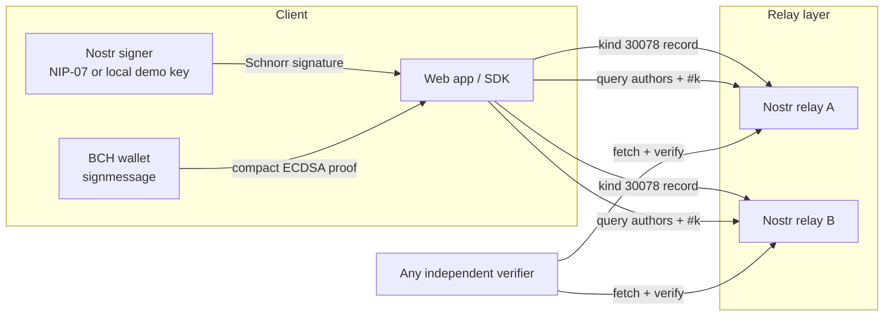

# KYVERA

**Identity. Proven.**

KYVERA is an open-source decentralized identity lifecycle protocol connecting Bitcoin Cash wallets with Nostr identities. It is a BCH Blaze 2026 submission for the Paytaca Decentralized Identity bounty.

The project answers a question that existing BCH↔Nostr bindings do not:

> After a wallet is rotated, revoked or compromised, how can an independent verifier determine which identity binding is authorized **now**?

A historical signature can remain cryptographically valid forever. Validity is not authorization. KYVERA separates the two.

---

## 1. What KYVERA is

A KYVERA identity is a Nostr key plus a sequence of signed, hash-linked authorization records:

- **Nostr key** — the durable identity handle. Its Schnorr signature authenticates every record.
- **BCH wallet** — the current payment identity. Its `signmessage` compact ECDSA signature proves control of the address.
- **Lifecycle chain** — `bind` at sequence 0, then `rotate` / `revoke` transitions. Each record commits to the previous record's digest.

A verifier resolves one of eight explicit outcomes:

| Status | Meaning |
| --- | --- |
| `ACTIVE` | Valid chain, current authorization, not revoked or expired. |
| `SUPERSEDED` | A real historical binding that has been rotated away from. |
| `REVOKED` | Explicitly revoked by the currently authorized keys. |
| `EXPIRED` | The current binding outlived its `expiresAt`. |
| `CONFLICT` | The identity key published competing records, or a fork exists. |
| `STALE` | The chain is incomplete or no relay could be reached. |
| `UNKNOWN` | No KYVERA records exist for the subject. |
| `INVALID` | Proofs, encoding or transitions failed verification. |

`ACTIVE` is never returned when the verifier cannot establish a sufficiently fresh state. Uncertainty is a first-class result, not an error message.

## 2. The problem

Existing bindings (including the closest public implementation, [`nostr-bch-bind`](https://gist.github.com/apeirs/aff6b63931c57e1a0729a72770abb325)) prove that two keys were associated once. They generally:

- select the newest valid event by `created_at`, without a hash-linked chain;
- have no notion of rotation (a new BCH address is just a new binding);
- allow revocation authorized by the Nostr key alone;
- cannot distinguish a stale relay from a quiet identity;
- do not define challenge-response authentication for relying applications.

KYVERA treats identity as a state machine with authorization rules, not as a directory of signatures. See [`docs/COMPETITOR_ANALYSIS.md`](docs/COMPETITOR_ANALYSIS.md) for source-level evidence and a comparison matrix.

## 3. Architecture

```text
apps/web/                 Next.js App Router UI (create, dashboard, verify, auth)
packages/core/            Canonical JSON, record model, chain state machine
packages/bch/             CashAddr handling, wallet signmessage signing/verification
packages/nostr/           NIP-78 event encoding, relay queries, publishing
packages/verifier/        Independent verifier, lifecycle SDK, challenge service, CLI
examples/                 Executable node verifier and lifecycle demonstration
tests/                    Unit, security and relay integration tests, deterministic vectors
scripts/                  Local demo relay, vector generator, demo seeder
docs/                     Protocol, threat model, requirements, competitor and test reports
```



No server sits in the verification path. The web application is a client of the same SDK that third parties use.

## 4. Protocol summary

- **Record publication:** NIP-78 event, kind `30078`, authored by the identity's Nostr key.
- **Canonical encoding:** KCJ-1 — sorted keys, no whitespace, NFC strings, safe integers only. Non-canonical content is rejected.
- **BCH proof:** `signmessage`-compatible compact recoverable ECDSA over a domain-separated message:
  ```text
  KYVERA/v1/bch-proof
  role:new|current
  address:<cashaddr>
  record:<sha256 of canonical payload>
  ```
  The public key is recovered from the signature; the address is its `hash160`. The key is never supplied by the claimant.
- **Nostr proof:** BIP-340 Schnorr signature over the event (the standard NIP-01 event id).
- **Chain link:** `previous = sha256(canonical previous signed record)`.
- **Authorization policy:**
  - `bind` — new BCH key + Nostr key
  - `rotate` — current BCH key + new BCH key + Nostr key
  - `revoke` — current BCH key + Nostr key; no transition may follow
- **Distinct keys:** a BCH public key whose x-only coordinate equals the Nostr key is rejected (`KEY_REUSE`).

Full byte-level rules, tag layout and state-transition algorithm: [`docs/PROTOCOL.md`](docs/PROTOCOL.md).

## 5. Supported signing formats

| Side | Format | Status |
| --- | --- | --- |
| Nostr | NIP-01 BIP-340 Schnorr event signature | Implemented and tested |
| Nostr | NIP-07 browser extension (`window.nostr.signEvent`) | Implemented in the web app |
| Nostr | Local demo key in the browser | Implemented, clearly labelled demo-only |
| Nostr | NIP-42-shaped kind `22242` challenge authentication | Implemented and tested |
| BCH | Wallet `signmessage` compact recoverable ECDSA (65 bytes, base64) | Implemented and tested |
| BCH | External wallet: copy the proof message, paste the signature | Implemented in the create flow |
| BCH | In-browser demo wallet | Implemented, clearly labelled demo-only |
| BCH | Multisig, P2SH, hardware-wallet PSBT flows | Not supported in v1 |

The wallet `signmessage` convention is the one used by Electron Cash, Cashonize and Paytaca (`hash256("\x18Bitcoin Signed Message:\n" + compactSize(len) + message)`). An independent signature from the `nostr-bch-bind` test vectors is verified in [`tests/interop.test.ts`](tests/interop.test.ts). A live test against a funded wallet was **not** performed in this workspace; see [remaining work](#15-repository-status-and-remaining-work).

## 6. Installation

Requirements: Node.js 20+, a package manager. The repository is configured for pnpm 9.

```bash
# If pnpm is not installed globally:
npm install -g pnpm@9.15.9
# or run every command through: npx pnpm@9.15.9 <command>

pnpm install
pnpm build          # builds packages, then the web app
```

Copy `apps/web/.env.example` to `apps/web/.env.local` for the web app, and adjust:

```bash
NEXT_PUBLIC_KYVERA_RELAYS=ws://127.0.0.1:7777
NEXT_PUBLIC_KYVERA_NETWORK=mainnet
NEXT_PUBLIC_KYVERA_DOMAIN=kyvera.local
```

The default is the local demo relay only. Add public relays (for example `wss://relay.damus.io`) when you intend to query and publish on the public network. The root `.env.example` documents the same values for reference; CLI users can set `KYVERA_RELAYS` in their shell.

## 7. Running locally

```bash
# terminal 1 — local Nostr relay (persists to .context/relay-events.json)
pnpm relay

# terminal 2 — web application at http://localhost:3000
pnpm dev

# terminal 3 — optional: seed a complete bind → rotate identity
pnpm demo
```

`pnpm relay` is a demo relay only: NIP-01 EVENT/REQ/CLOSE, signature checking, in-memory store with a JSON snapshot. It has no auth, rate limits or NIP-11 document.

## 8. Running tests

```bash
pnpm test           # 82 tests across 9 files
pnpm typecheck      # strict TypeScript for every package
pnpm build          # production build
pnpm demo:lifecycle # executable lifecycle demo with assertions
```

Deterministic vectors live in [`tests/fixtures/vectors.json`](tests/fixtures/vectors.json) and are reproducible:

```bash
pnpm vectors
```

## 9. Verifying an identity independently

### CLI

```bash
pnpm cli npub1… --relay wss://relay.damus.io --relay wss://nos.lol
pnpm cli --address bitcoincash:q… --relay wss://nos.lol
pnpm cli --file events.json
```

Exit code `0` means a conclusive lifecycle state (`ACTIVE`, `SUPERSEDED`, `REVOKED`, `EXPIRED`). Exit code `1` means uncertain or invalid (`STALE`, `CONFLICT`, `UNKNOWN`, `INVALID`). `--json` emits the complete machine-readable resolution.

### SDK

```ts
import { resolveIdentity } from "@kyvera/verifier";

const result = await resolveIdentity({
  subject: "64-char-hex-nostr-public-key",
  relays: ["wss://relay.damus.io", "wss://nos.lol"],
});

if (result.status === "ACTIVE") {
  // result.activeBch.address is the currently authorized destination
}
```

Offline verification of an event set:

```ts
import { resolveEvents } from "@kyvera/verifier";
const { resolution } = resolveEvents(events, { now: Math.floor(Date.now() / 1000) });
```

No API key, hosted service or KYVERA backend is involved.

## 10. Performing a rotation

In the demo dashboard, **Prepare rotation → Rotate now** generates a new BCH keypair and publishes a sequence N+1 record signed by:

1. the current BCH private key (authorizes leaving),
2. the new BCH private key (proves control of the destination),
3. the Nostr identity key (binds the transition to the identity).

Programmatically:

```ts
import { createRotateRecord, previousStateFrom } from "@kyvera/verifier";

const rotation = await createRotateRecord({
  signer,                                  // current Nostr signer
  previous: previousStateFrom(headRecord), // current head
  currentBchPrivateKey: oldWallet,
  newBchPrivateKey: newWallet,
  newBch: newBchIdentity,
});
```

A rotation signed without any one of those three keys is rejected. Losing the current BCH key blocks rotation; there is no hidden recovery shortcut.

## 11. Demonstration steps

1. Start `pnpm relay` and `pnpm dev`.
2. Open `http://localhost:3000/create`.
3. Generate a demo Nostr key and a demo BCH wallet (or connect NIP-07 and sign with an external wallet).
4. Inspect the exact BCH proof message and canonical Nostr content.
5. Publish. Open the identity dashboard.
6. Rotate to a new wallet. Confirm the old address becomes `SUPERSEDED`.
7. Verify the same npub in the public verifier and from the CLI.
8. Revoke the identity. Confirm the verifier returns `REVOKED` and no payment address.
9. Run `pnpm demo:lifecycle` for the same sequence as an assertion-based terminal demo, including rejected forgery, rollback detection and equivocation.

Do not fund any demo address. Demo keys are throwaway material stored in browser localStorage.

## 12. Security assumptions

- The Nostr identity key is controlled only by the identity owner.
- The current BCH wallet key is controlled by the identity owner.
- Relays are untrusted transport. They may omit, reorder or equivocate; they cannot forge signatures.
- The verifier's clock is approximately correct; records issued more than 10 minutes in the future are rejected.
- Off-chain protocols cannot prove completeness of history. `STALE` communicates missing history; optional checkpoints detect known rollbacks.
- Browser localStorage is not a secure keystore. It is used only for the explicitly labelled demo signer.

See [`docs/THREAT_MODEL.md`](docs/THREAT_MODEL.md) and [`docs/SECURITY_LIMITATIONS.md`](docs/SECURITY_LIMITATIONS.md).

## 13. Known limitations

- **No recovery.** Losing both the current BCH key and the Nostr key means the identity cannot be advanced or revoked. This is documented policy, not an accidental shortcut.
- **Rollback resistance is not absolute.** A relay set that withholds newer history cannot be detected without an external checkpoint. The SDK supports an optional `(sequence, recordId)` checkpoint.
- **Relays may prune history.** Addressable NIP-78 events are keyed per subject/sequence/digest, but relays are free to drop old events. A verifier then reports `STALE`, never an older active binding.
- **P2PKH only.** v1 does not support multisig, P2SH, CashTokens or hardware-wallet signing flows.
- **No live wallet test.** The signmessage format is implemented and cross-verified against an independent vector, but not yet exercised against a funded Electron Cash/Cashonize/Paytaca wallet in this workspace.
- **No security audit.** This is a hackathon prototype. Do not use it to secure real funds.
- **Demo key storage.** The browser demo stores throwaway private keys in localStorage so rotation and revocation can be demonstrated; production clients should never do this.

## 14. Bounty alignment

The official requirements and a requirement-to-code/test/demo traceability matrix are in [`docs/HACKATHON_REQUIREMENTS.md`](docs/HACKATHON_REQUIREMENTS.md). Summary:

| Requirement | Status |
| --- | --- |
| Identity creation & management, self-custodial | Implemented (demo signer + NIP-07 + external BCH path) |
| Cryptographic BCH↔Nostr binding, distinct keys | Implemented and tested |
| Decentralized discovery via Nostr | Implemented and integration-tested |
| Verification & challenge-response authentication | Implemented and tested |
| Working demonstration & documentation | Implemented; deployment/video pending |

Stretch goals implemented: **key rotation and recovery with independently verifiable authorization** (rotation and revocation; recovery explicitly not claimed), **reusable libraries and protocol spec**.

## 15. Repository status and remaining work

Honest status as of 2026-11-18:

- [x] Protocol specification, threat model, canonical encoding
- [x] BCH + Nostr dual-key binding, rotation, revocation
- [x] Chain resolution with eight explicit result states
- [x] Relay discovery, partial-sync and rollback-checkpoint handling
- [x] Independent TypeScript SDK and CLI
- [x] 82 automated tests, deterministic vectors, executable lifecycle demo
- [x] Responsive web application, verified end-to-end in Chrome
- [x] Local relay and reproducible offline demo
- [ ] Live wallet interoperability test (Electron Cash / Cashonize / Paytaca)
- [ ] Public GitHub push, deployment, demo video, bounty submission
- [ ] Independent security review

Deadline note: the workspace brief states **22 November 2026, 19:30 IST**, while the official site currently advertises **14–28 November 2026**. The deadline must be confirmed on DoraHacks before submission.

## 16. Future development

- WalletConnect/WizardConnect integration so rotation can be authorized directly from Cashonize/Electron Cash.
- CashTokens commitments for on-chain anchoring of identity state.
- Hardware-wallet PSBT proofs and multisig policies.
- Pre-authorized recovery keys with an explicit, documented threshold policy.
- Relay-side indexing conventions and a NIP for lifecycle records.
- Optional on-chain checkpoints for stronger rollback detection.

## 17. License

MIT. See [LICENSE](LICENSE).

---

**Primary principle:** cryptographic correctness before visual complexity. Every state shown in the application comes from verification of real signed events; there are no mock success states.
