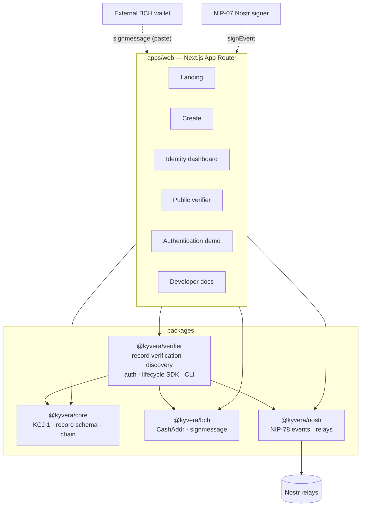
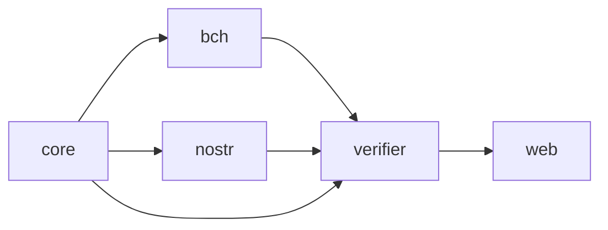
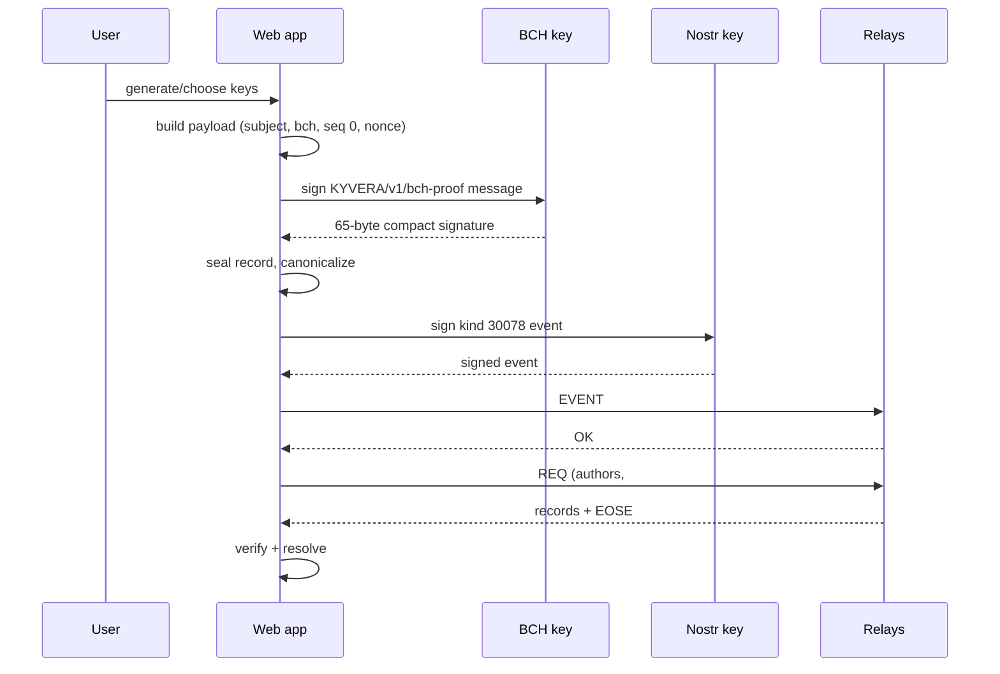
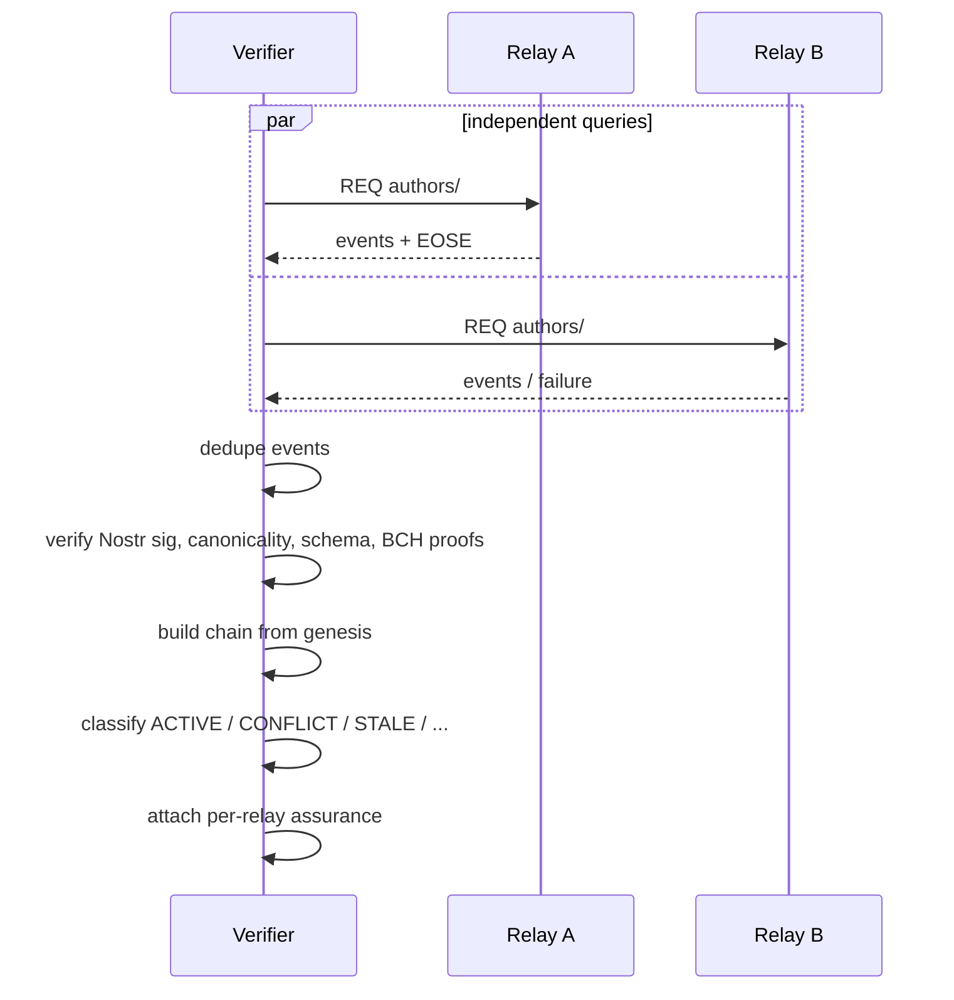
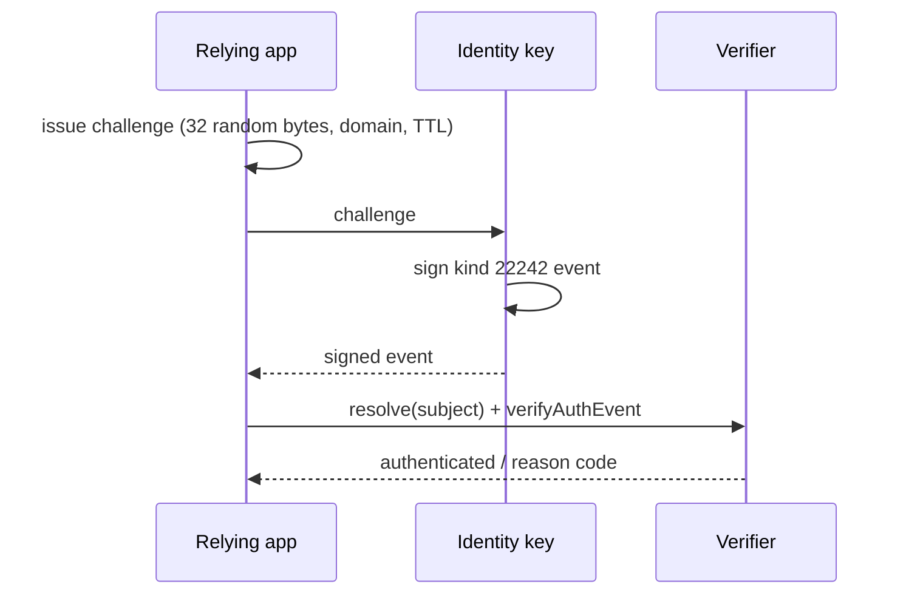

# KYVERA Architecture

**Date:** 2026-11-18
**Status:** v1 hackathon prototype

---

## 1. Shape of the system

KYVERA is a TypeScript monorepo with no backend in the verification path. The web app is a client of the same SDK a third party would install.



### 1.1 Package responsibilities

| Package | Responsibility | May depend on |
| --- | --- | --- |
| `@kyvera/core` | Types, KCJ-1 canonicalization, strict record schema, proof-message construction, chain state machine. No network, no signing, no relay code. | `libauth` (hashing only) |
| `@kyvera/bch` | CashAddr decoding, P2PKH checks, Bitcoin Signed Message hashing, compact signature recovery, key utilities. | `core`, `libauth` |
| `@kyvera/nostr` | Unsigned/signed event construction, tag matrix, event parsing, per-relay querying and publishing. Browser and Node. | `core`, `nostr-tools`, `ws` (Node only, lazy) |
| `@kyvera/verifier` | Composes the packages: `verifyRecord`, `verifyEventRecord`, `resolveEvents`, `resolveIdentity`, `resolveAddress`, challenge service, record construction, CLI. | all three |
| `@kyvera/web` | UI and browser state. No protocol rules of its own. | all packages |

The dependency direction is deliberate:



`core` has no knowledge of relays or ECDSA signatures. It can be embedded anywhere. Chain logic is pure and independently testable.

---

## 2. Runtime flows

### 2.1 Create (bind)



The UI never sees a private key for external modes. The external BCH path displays the message and accepts a pasted signature; the NIP-07 path delegates event signing to the extension.

### 2.2 Verify



Relay queries run in parallel, each with its own connection timeout and EOSE timeout. A relay that never sends EOSE still contributes events but lowers assurance to `PARTIAL`. Sensitive payment and authentication/session actions require `FULL`; `PARTIAL` is fail-closed for those actions.

### 2.3 Rotate

1. Resolve the current head; require `ACTIVE`.
2. Build payload with `sequence + 1` and `previous = head.recordId`, new address.
3. Sign role `current` with the old BCH key.
4. Sign role `new` with the new BCH key.
5. Sign the event with the Nostr key.
6. Publish.
7. Re-resolve; old address becomes `SUPERSEDED`.

The web UI locks lifecycle actions unless `status === "ACTIVE"`, preventing a fork from a stale head.

### 2.4 Authenticate



Resolution is needed because a valid key signature is not enough: the identity must be `ACTIVE`, not revoked/expired/stale/conflicting.

---

## 3. Browser / Node boundaries

| Concern | Browser | Node (CLI, tests) |
| --- | --- | --- |
| Crypto | `libauth`, `@noble/curves` via nostr-tools | same |
| Randomness | `globalThis.crypto.getRandomValues` | Node 20 global webcrypto |
| WebSocket | native `WebSocket` | lazy `import("ws")` installed once via `useWebSocketImplementation` |
| Key storage | localStorage (demo only) | memory / caller-supplied |
| Relay discovery | `@kyvera/nostr` | same |
| Packaging | Next bundling with `webpackIgnore` for `ws` | direct ESM |

`packages/nostr/src/relay.ts` checks for a global WebSocket before importing `ws`, so the same code runs in both environments without a separate entry point.

## 4. Data model and invariants

- A record is `{ payload, proofs.bch[] }`.
- `payloadDigest = sha256(KCJ-1(payload))`.
- `recordId = sha256(KCJ-1(record))`.
- `payload.previous` points at the previous `recordId`.
- The event `content` is exactly `KCJ-1(record)`.
- The event `d` tag includes the `payloadDigest`, so equivocations coexist.
- `activeBch` is non-null only for `ACTIVE` and `EXPIRED`.

Key invariants are enforced by `packages/core/src/chain.ts` and covered by tests:

1. The chain starts at exactly one genesis.
2. Sequence increases by one.
3. Previous digest matches exactly.
4. The current proof address equals the chain's authorized address.
5. No transition follows a revocation.
6. Any competing valid record produces `CONFLICT`.
7. A missing link produces `STALE`, not a fallback.

## 5. Error model

The SDK never throws for expected invalid input. It returns discriminated results:

```ts
type VerifyRecordResult = { ok: true; ... } | { ok: false; code: string; message: string };
type IdentityStatus = "ACTIVE" | "SUPERSEDED" | ...;
```

Exceptions are reserved for programmer errors (invalid arguments, missing relay list) or environment failures. The CLI maps conclusive states to exit code 0 and uncertain/invalid states to 1, so scripts can distinguish them.

Reason codes are stable and machine-readable (`CHAIN_FORK`, `MISSING_CHAIN_SEGMENT`, `ROLLBACK_DETECTED`, `KEY_REUSE`, etc.), which matters more than free-text messages for integrators.

## 6. Relay layer

`queryRelay` creates a fresh connection per query, subscribes, collects unique events until EOSE or timeout, sends CLOSE while the socket is open, then closes. This avoids a known console error from closing with an open subscription and keeps relay failures isolated.

`queryRelays` returns:

```ts
{
  reports: [{ url, ok, eose, events, error, latencyMs }],
  events: deduped[]
}
```

The verifier turns this into an assurance level. It does not hide failures behind a single boolean.

The local demo relay (`scripts/local-relay.mjs`) implements the same NIP-01 subset and persists to `.context/relay-events.json`. It is explicit demo infrastructure, not part of the protocol.

## 7. Build and tooling

| Choice | Reason |
| --- | --- |
| pnpm workspaces | Strict dependency layout; workspace linking; fast installs |
| TypeScript strict | Catch protocol mistakes at compile time |
| Vitest | Fast ESM tests, aliases to source for dev |
| Next.js App Router + Tailwind | Minimal client app; static pages; no API routes in the verification path |
| `@bitauth/libauth` | Audited BCH primitives; no custom curve code |
| `nostr-tools` | Standard NIP-01 event and relay handling |
| tsx | Run TS demo/vector scripts without a build step |
| Playwright (dev only) | Browser end-to-end verification and screenshots |

`pnpm build` builds packages first (topological order) and then the Next app. `pnpm dev` has a `predev` step that builds the packages so the app never consumes stale `dist/` output.

## 8. Testing architecture

| Layer | Location | What it proves |
| --- | --- | --- |
| Pure chain | `tests/chain.test.ts`, `rotation`, `revocation` | State transitions and conflict semantics |
| Crypto | `binding.test.ts`, `interop.test.ts` | Signature verification, key recovery, independent vector |
| Discovery | `relay.test.ts` with a real local WebSocket relay | Publishing, querying, partial sync, rollback detection |
| Auth | `auth.test.ts` | Challenge binding, replay, status gating |
| Vectors | `vectors.test.ts` + `tests/fixtures/vectors.json` | Cross-run determinism and reproducible bytes |
| Lifecycle | `examples/identity-lifecycle/run.ts` | End-to-end assertions in one command |
| UI | `scripts/browser-demo.mjs` (Playwright, dev only) | Real create → rotate → verify → auth → revoke flow |

Mocks are limited to failure injection at the relay boundary. Signatures, hashing, records and chain resolution are always real.

## 9. Deployment plan (not performed)

The application can be deployed to Vercel or any Node host:

1. Set `NEXT_PUBLIC_KYVERA_RELAYS` to public relays (do not include localhost).
2. Set `NEXT_PUBLIC_KYVERA_NETWORK`.
3. Build with `pnpm build`; the web app is a standard Next.js production build.
4. Optionally serve the CLI from a static build of the verifier package.

There is no database, server-side session or secret to provision. This is a property of the design, not an incomplete deployment setup.

## 10. Known architectural limitations

- Addressable events depend on relay retention. A relay may prune old records; the verifier then reports `STALE`.
- There is no relay reputation, retry/backoff policy, or authenticated relay access.
- The browser app performs resolution on every page load; there is no shared cache or service worker.
- The demo relay is single-process and in-memory.
- The package is not yet published to npm; consumers use the workspace or a git dependency.
- No indexer is defined for discovering all identities efficiently; address lookup uses the `#b` tag and subject lookup uses the author filter.

These are appropriate boundaries for a focused proof of concept and are listed as future work rather than hidden.
