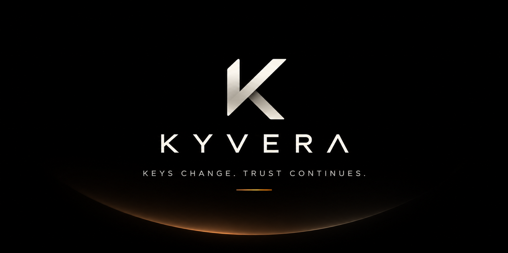
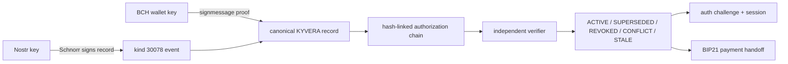

# KYVERA — Submission Package

**Project:** KYVERA — The Identity Continuity Protocol
**Tagline:** Your keys change. Your identity continues.
**Bounty:** BCH Blaze 2026 · Paytaca Decentralized Identity

---



## 1. Public links

| Item | URL |
| --- | --- |
| **Live website** | https://kyvera-alpha.vercel.app |
| **V5 product film** | https://kyvera-alpha.vercel.app/demo/kyvera-v5-product-film.mp4 (120s, narrated, AAC, captions) |
| **Homepage preview** | https://kyvera-alpha.vercel.app/demo/kyvera-v5-preview.mp4 (15s, silent, loopable) |
| **Poster** | https://kyvera-alpha.vercel.app/demo/kyvera-v5-poster.webp |
| **Tutorial cinema** | https://kyvera-alpha.vercel.app/tutorial |
| **Previous 90-second explainer** | https://kyvera-alpha.vercel.app/demo/kyvera-explainer-90s.mp4 (97s) |
| **Previous three-minute walkthrough** | https://kyvera-alpha.vercel.app/demo/kyvera-judge-demo-3min.mp4 (189s) |
| **Trust Challenge** | https://kyvera-alpha.vercel.app/challenge |
| **Standalone verifier** | https://kyvera-alpha.vercel.app/kyvera-standalone.html |
| **GitHub** | https://github.com/sakethdonepudi/kyvera-protocol (public) |
| **Release** | https://github.com/sakethdonepudi/kyvera-protocol/releases/tag/v5.0.2 |
| **Deployed commit** | `da86470` (also exposed as `<meta name="kyvera-commit">`); release tag `v5.0.2` |

The GitHub repository is **public**; the deployed site is public.

---

## 2. Brand assets

Approved raster identity is in `apps/web/public/brand` (black-background artwork; not vector). The K emblem is used for navigation, footer, favicon and application icons; the primary logo is used on the tutorial, Open Graph preview and video intro/outro.

## 2. Problem

A BCH wallet address can change after rotation or compromise. A Nostr identity can
persist. A historical BCH signature remains mathematically valid forever.

Existing BCH–Nostr bindings answer “were these keys associated once?” They do not
reliably answer:

> Which wallet is authorized **now**, and which old proofs are merely history?

A newest-event rule cannot distinguish a replay from a rotation, or a quiet
identity from a relay withholding history.

## 3. Solution

KYVERA is a decentralized identity-continuity protocol that independently verifies
BCH–Nostr bindings and tracks which wallet authorization is valid across rotation
and revocation.

- A genesis binding is signed by both the BCH wallet key and the Nostr key.
- Every later record commits to the previous record's digest.
- Rotation requires the current BCH key, the new BCH key and the Nostr key.
- Revocation requires the current BCH key and the Nostr key and ends the chain.
- Verification is a library call. No KYVERA server is in the trust path.

## 4. Key differentiators

1. **Hash-linked authorization chain** rather than newest-event-wins.
2. **Explicit result space:** `ACTIVE`, `SUPERSEDED`, `REVOKED`, `EXPIRED`,
   `CONFLICT`, `STALE`, `UNKNOWN`, `INVALID`.
3. **Historical proof ≠ current authorization**: an old proof can verify while the
   address is no longer current.
4. **Fail-closed sensitive actions:** payment and authentication require
   `ACTIVE` + `FULL` relay agreement; `PARTIAL`/`UNSYNCED`/`STALE`/`CONFLICT`/
   `REVOKED`/`INVALID` do not authorize.
5. **Independent relying party** with single-use, origin/session/identity-bound
   challenges and short-lived sessions.
6. **Honest uncertainty:** withheld history can produce `STALE`; first-contact
   rollback limits are documented, not hidden.

## 5. Architecture



Packages:

- `packages/core` — KCJ-1 canonicalization, schema, chain state machine.
- `packages/bch` — CashAddr and `signmessage` verification.
- `packages/nostr` — kind-30078 events and relay discovery.
- `packages/verifier` — record verification, chain resolution, auth/session, CLI.
- `apps/web` — Next.js product UI.
- `examples/relying-party` — framework-independent RP demo.

## 6. Cryptographic model

- **Canonical bytes:** KCJ-1; sorted keys, NFC values, safe integers only, strict
  schema and exact `content === canonicalize(parse(content))`.
- **BCH proof:** compact recoverable ECDSA over
  `KYVERA/v1/bch-proof\nrole:…\naddress:…\nrecord:<digest>`.
- **Nostr proof:** BIP-340 Schnorr over the kind-30078 event.
- **Key separation:** BCH and Nostr keys must be distinct; checked on the recovered
  key, including uncompressed BCH signatures and external wallet binds.
- **Chain:** sequence `+1`, exact predecessor digest, monotonic `issuedAt`, proof
  role matrix, revocation terminal.
- **Auth:** 32-byte challenge, 120s request, 900s session, origin/session/subject/
  address/protocol/expiry binding, single use, replay rejection.

## 7. Identity rotation and revocation

- Old wallet A authorizes leaving.
- New wallet B proves control of the destination.
- The Nostr key binds the transition to the identity.
- Wallet A becomes `SUPERSEDED`; its historical proof remains valid.
- Revocation requires the current wallet and the Nostr key and ends the chain.
- Conflicting sequence records produce `CONFLICT`; missing segments produce
  `STALE`, never a silent fallback.

## 8. Independent authentication

`/auth-demo` and `/challenge` exercise a relying party that:

1. issues a fresh challenge bound to origin, session, intended subject, address,
   protocol and expiry;
2. verifies the signature against a freshly resolved chain;
3. rejects replay, expiry, mismatched origin/session, unauthorized rotation,
   revoked and stale states;
4. issues a short-lived session only after success;
5. invalidates the session after logout, rotation or revocation.

`pnpm rp:demo` is a separate Node application using only the public packages. It
prints 13/13 checks with no KYVERA API or relay. `pnpm rp:persist` adds a durable file-backed store and 7/7 checks for session persistence, rotation invalidation and revocation invalidation.

## 9. Decentralized discovery

Each record is dual-published:

- public regular event kind `1078` (experimental, unregistered);
- legacy NIP-78 kind `30078` mirror.

Both carry the unique `d` tag `kyvera:v1:<subject>:<sequence>:<payload digest>`.
The verifier accepts both, queries both and de-duplicates by record ID.

NIP-78 is private application data and may be AUTH-gated, so it is no longer the
sole public discovery mechanism. See `docs/protocol/NOSTR_DISCOVERY_RFC.md`.

The verifier queries configured relays, reports per-relay status, and surfaces
`FULL` / `PARTIAL` / `UNSYNCED`. Sensitive actions fail closed unless every relay
responds. Missing history returns `STALE`; conflicting branches return `CONFLICT`.

Public evidence: a disposable bind → rotate → revoke lifecycle was published to
`wss://nos.lol` and `wss://relay.primal.net`; both relays accepted both envelopes,
the full 3-record history was reconstructed, a forged rotation was rejected, and
short-term retention was observed. See `docs/audits/DISCOVERY_EVIDENCE.md`.

## 10. Testing evidence

| Check | Result |
| --- | --- |
| Unit / integration / security | **154/154**, 16 files |
| Browser QA | **64/64**, 0 console/page errors |
| Production build | pass, 17 routes |
| Standalone relying party | **13/13** |
| Durable relying party | **7/7** |
| Production HTTPS smoke | pass, 9 routes, headers, bundle, video |
| Relay health | 2/2 (`wss://nos.lol`, `wss://relay.primal.net`) |
| Dependency audit | 0 known vulnerabilities |
| Fresh clone | install/test/build pass |
| Accessibility | no unnamed controls; keyboard/reduced-motion checks |
| Secret scan | no tracked private keys or populated env secrets |

## 11. Screenshots

- [Landing](screenshots/landing.png)
- [Create Identity](screenshots/create.png)
- [Trust Challenge — Prove](screenshots/challenge-prove.png)
- [Independent verifier](screenshots/verifier.png)
- [Authentication](screenshots/authentication.png)
- [Merchant rotation](screenshots/merchant-rotated.png)
- [Payment handoff](screenshots/pay-handoff.png)
- [Embedded tutorial player](screenshots/tutorial-player.png)
- [Time Machine](screenshots/time-machine.png)

## 12. Bounty requirement mapping

See [`REQUIREMENTS_MATRIX.md`](REQUIREMENTS_MATRIX.md) and
[`PAYTACA_COMPLIANCE.md`](PAYTACA_COMPLIANCE.md).

| Requirement | Evidence |
| --- | --- |
| R1 identity creation / management | `/create`, 154 tests, browser QA |
| R2 dual-key binding | `/challenge` Bind, binding/vector/property tests |
| R3 decentralized discovery | public kind 1078 + legacy kind 30078; two-relay lifecycle evidence; relay tests |
| R4 verification & authentication | `/auth-demo`, `/challenge`, `pnpm rp:demo` 13/13, `pnpm rp:persist` 7/7 |
| R5 working prototype + docs | live site, GitHub, videos, `@kyvera/sdk`, `@kyvera/wallet-bch`, CLI, standalone verifier |
| Rotation stretch | rotation, Time Machine, challenge Rotate/Prove |
| Payment stretch | BIP21 handoff only; no txid or transaction claim |

## 13. Security limitations

- No independent security audit or formal verification.
- No physical Paytaca/Cashonize/Selene test; no wallet-produced signature recorded.
- Public-relay retention was observed short-term on two relays; indefinite retention and global completeness are not proven.
- A relay set that withholds a newer revocation can still look `ACTIVE`; a
  checkpoint mitigates rollbacks after a previously observed head.
- `/pay` is a BIP21 handoff. It does not construct/broadcast a transaction,
  receive a txid or display a receipt.
- Auth challenges/sessions are in-memory in the demo.
- Demo keys are throwaway browser-local data and must never hold funds.
- No Mainnet Track eligibility claim.

## 14. Installation and independent use

```bash
git clone https://github.com/sakethdonepudi/kyvera-protocol.git
cd kyvera-protocol
pnpm install --frozen-lockfile
pnpm test
pnpm typecheck
pnpm build
pnpm relay
pnpm dev
```

Standalone verifier: open `demo/kyvera-standalone.html` (no install) or
`/kyvera-standalone.html` on the live site.

Independent relying party:

```bash
pnpm rp:demo
```

## 15. Video files

- `apps/web/public/demo/kyvera-v5-product-film.mp4` — 1920×1080, H.264, AAC 48kHz, 30fps, 120s
- `apps/web/public/demo/kyvera-v5-product-film.vtt` — 26 WebVTT cues
- `apps/web/public/demo/kyvera-v5-preview.mp4` — 1920×1080, silent, 15s
- `apps/web/public/demo/kyvera-v5-poster.webp` — 1920×1080 poster
- `apps/web/public/demo/kyvera-explainer-90s.mp4` — previous 97s explainer, retained
- `apps/web/public/demo/kyvera-judge-demo-3min.mp4` — previous 189s walkthrough, retained
- Both open and close with a 2.4s reveal of the approved primary logo.
- Narration: Microsoft Edge Neural TTS, `en-US-AndrewNeural`; scripts and audio evidence in [`VIDEO_NARRATION.md`](VIDEO_NARRATION.md).
- Posters and WebVTT captions are in the same directory.
- Embedded with native controls at `/tutorial`; no autoplay with sound.

## 16. Explicit non-claims

KYVERA does **not** claim:

- an independent security audit;
- production readiness;
- guaranteed global revocation visibility;
- verified real-wallet compatibility;
- a completed on-chain payment or Mainnet eligibility.
