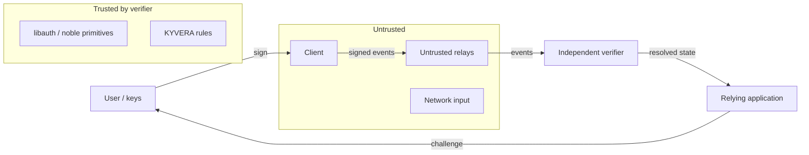

# KYVERA Threat Model

**Version:** 1
**Date:** 2026-11-18
**Scope:** the v1 protocol, SDK, CLI, demo relay and browser application in this repository.
**Status:** hackathon prototype; not independently audited.

---

## 1. Security goals

1. **Authenticity.** A verifier can establish that the BCH key and Nostr key authorized the exact record presented.
2. **Key separation.** Compromise or proof of one key does not imply control of the other.
3. **Current-state integrity.** A verifier can distinguish the currently authorized BCH address from a valid historical one.
4. **Transition authorization.** Rotation and revocation are accepted only under the documented two-key policy.
5. **Equivocation visibility.** Competing valid records are surfaced as `CONFLICT`, not silently resolved.
6. **Freshness honesty.** Missing relays or history produce `STALE`/`PARTIAL`, never an older `ACTIVE`.
7. **Independent verification.** No KYVERA server, account or API key is required to reach a result.

## 2. Non-goals

- Protecting a user who has lost every authorized key.
- Proving completeness of off-chain history to a verifier with no prior state and a colluding relay set.
- Anonymity or metadata privacy. Published records are public and link a Nostr key to BCH addresses.
- Custody of funds, transaction construction, or wallet UX beyond the proof.
- Multisig, hardware wallets, CashTokens, DIDs/VCs, recovery policies.
- Defending against a compromised device or browser extension.
- Post-quantum security.

## 3. Assets

| Asset | Sensitivity | Location |
| --- | --- | --- |
| Nostr private key | Critical | User's signer; demo: localStorage |
| BCH private key (current and historical) | Critical | User's wallet; demo: localStorage |
| Authorization chain (records) | Public | Nostr relays; local cache |
| Current BCH address | Public | Records, UI |
| Relying-app challenge and session state | Medium | Relying app |
| Demo relay event store | Public | `.context/relay-events.json` |

## 4. Actors and trust boundaries



- **Trusted:** the verifier's own code, its clock (approximately), the cryptographic libraries, and the user's signer device.
- **Untrusted:** relays, event order, event timestamps as claims, the web client's storage, any HTTP/WebSocket transport, and all input.
- **Not in the trust path:** the KYVERA website. It is a client of the same SDK.

## 5. Assumptions

| ID | Assumption | If violated |
| --- | --- | --- |
| A1 | The subject's Nostr key is not controlled by an attacker. | Attacker can publish records but still needs the current BCH key for rotate/revoke; they can equivocate and DoS the identity. |
| A2 | The current BCH key is not controlled by an attacker. | Attacker cannot rotate alone (needs Nostr key); can revoke only with Nostr key. |
| A3 | Verifier clock is within ±10 minutes. | Future-dated records may be accepted or rejected incorrectly; challenge windows shift. |
| A4 | SHA-256 and secp256k1 are secure. | Total compromise. |
| A5 | Implementations agree on KCJ-1 and signature encoding. | Parser differentials; mitigated by strict canonicality checks. |
| A6 | Relays are untrusted but cannot forge signatures. | Forged records rejected cryptographically. |
| A7 | Demo keys in localStorage are throwaway. | Theft of demo keys has no financial value; production clients must not do this. |

## 6. Threat catalogue

Each threat lists the attack path, mitigation, residual risk and the test or code that exercises it.

### T1 — Stolen Nostr key

**Path:** Attacker obtains the Nostr private key. They can sign new records as the subject.

**Mitigation:** Rotation and revocation require the current BCH key. The attacker can publish conflicting records (causing `CONFLICT`) or a new genesis (causing `GENESIS_EQUIVOCATION`), but cannot move the payment address or revoke cleanly.

**Residual:** Denial of service and equivocation are possible. A *new* identity under the stolen key is indistinguishable from the legitimate user starting over, unless consumers pin history. Recovery is not implemented.

**Tests:** `rotation.test.ts` "rejects a stolen Nostr key rotating without the BCH key"; `chain.test.ts` genesis conflict.

### T2 — Stolen BCH key

**Path:** Attacker controls the current wallet key.

**Mitigation:** Rotation requires the Nostr key; revocation requires the Nostr key. The attacker cannot silently replace the identity or revoke it.

**Residual:** The attacker can spend funds at that address. KYVERA is not a custody system. If the legitimate user rotates, the attacker's key becomes historical and is reported `SUPERSEDED`.

### T3 — Theft of both keys

**Path:** Full identity compromise.

**Mitigation:** None within the protocol. This is equivalent to full account takeover.

**Residual:** Attacker can rotate to their own wallet or revoke. Only out-of-band detection and a new identity help. This is stated as a non-goal.

### T4 — Malicious relay equivocation

**Path:** A relay serves different valid records to different verifiers, or withholds one branch.

**Mitigation:** Every valid record at a sequence is collected; more than one yields `CONFLICT`. Genesis equivocation and chain forks are explicit. The `d` tag includes the payload digest, so conflicting records are distinct addressable events and can coexist.

**Residual:** A relay that only shows one branch to a verifier that queries only that relay is indistinguishable from the truth. Query multiple relays; assurance reflects partial sync but not collusion.

**Tests:** `rotation.test.ts` duplicate sequence; `relay.test.ts` conflicting chains.

### T5 — Replay of an old binding

**Path:** Re-publish an old, valid `bind` or `rotate` event after a newer state exists.

**Mitigation:** Records are chained by record id; old records are placed in history or ignored, never treated as the head. Replayed events deduplicate by event id and record id. Address lookups classify old addresses as `SUPERSEDED`.

**Residual:** If the verifier only receives the old event set (relay withholding), see T8.

**Tests:** `rotation.test.ts` replay; `revocation.test.ts` replayed binding after revocation; `chain.test.ts` order independence.

### T6 — Forged transition

**Path:** Craft a `rotate` that moves to an attacker address without the old wallet's consent.

**Mitigation:** The `current` proof must recover to the address authorized by the previous chain record. The proof message commits to the exact payload, role and address.

**Tests:** `rotation.test.ts` unauthorized current key, chain address mismatch, forged payload.

### T7 — Reused key across identities

**Path:** Use the Nostr key as the BCH key or derive one from the other, collapsing both authorization domains.

**Mitigation:** The verifier rejects a BCH key whose x-only coordinate equals the subject. The demo generates independent keys.

**Tests:** `binding.test.ts` key reuse.

### T8 — Stale or withholding relay / rollback

**Path:** A relay returns only an older binding, making a superseded address look current.

**Mitigation:** Per-relay reports; `PARTIAL` if some fail; `UNSYNCED`/`STALE` if none respond. Optional checkpoint on `(sequence, recordId)` detects a known rollback (`ROLLBACK_DETECTED`) or a rewritten history (`CHECKPOINT_MISMATCH`).

**Residual:** Without a checkpoint or an independent source of the head, off-chain history completeness cannot be proven. This is stated explicitly rather than sold as absolute rollback protection.

**Tests:** `relay.test.ts` rollback checkpoint, unreachable relays, partial sync.

### T9 — Incomplete history / pruned relay

**Path:** Relays drop old events; the verifier sees only a later transition.

**Mitigation:** A missing genesis or sequence yields `STALE`, and `activeBch` is null. The verifier never falls back to a historical address.

**Tests:** `chain.test.ts` missing genesis; `rotation.test.ts` skipped sequence.

### T10 — Parser differential / non-canonical encoding

**Path:** Two implementations parse the same JSON differently, or an attacker uses duplicate keys/whitespace to produce two meanings for one signature.

**Mitigation:** Strict KCJ-1 canonicalization; the published content must be byte-identical to the canonical re-encoding; unknown fields rejected; safe integers only; depth limit; strings NFC-normalized.

**Tests:** `binding.test.ts` non-canonical content; `vectors.test.ts` canonical samples.

### T11 — Cross-protocol signature reuse

**Path:** Reuse a wallet signature from another protocol or another role.

**Mitigation:** BCH proof messages are domain-separated with `KYVERA/v1/bch-proof`, role, address and payload digest. Nostr events are NIP-01 events of kind 30078 with a `k` tag; kind 22242 is used for auth.

**Residual:** A wallet that signs arbitrary opaque messages can be tricked by a phishing prompt; the user must inspect the displayed message.

### T12 — Address substitution in the proof

**Path:** Present a valid signature for address A while claiming address B.

**Mitigation:** The address is included in the signed message and the recovered key is hashed and compared to the declared P2PKH payload.

**Tests:** `binding.test.ts` cross-address and wrong-wallet tests.

### T13 — Signature malleability

**Path:** Modify an ECDSA signature without invalidating it.

**Mitigation:** Any change to the signature changes the record content, which changes the Nostr event content and requires a new Schnorr signature by the subject. The chain commits to the full signed record, not only the payload.

**Residual:** ECDSA high-S variants are not rejected, but they cannot yield a different authorized record without the Nostr key.

### T14 — Forged revocation

**Path:** Revoke someone else's identity, or revoke with only one key.

**Mitigation:** A revoke record requires a `current` proof by the address authorized by the chain, plus the Nostr event signature. Signature alone is not enough: the claimed address must equal the chain's current address.

**Tests:** `revocation.test.ts` unauthorized, Nostr-only, wrong chain key.

### T15 — Post-revocation resurrection

**Path:** Publish a rotation after a revocation to bring the identity back.

**Mitigation:** Chain traversal stops at a revoke. Any later valid record yields `CONFLICT` (`TRANSITION_AFTER_REVOKE`).

**Tests:** `rotation.test.ts` after revocation.

### T16 — Authentication replay

**Path:** Replay a previously valid signed challenge response.

**Mitigation:** Random 32-byte challenge, domain and protocol tags, time window, single-use registry in `ChallengeService`. The event must be signed by the active subject.

**Residual:** A relying app with a broken challenge store can be replayed. Production apps must persist used challenges for the TTL.

**Tests:** `auth.test.ts` replay, expiry, wrong domain/challenge, tamper.

### T17 — Phishing across domains

**Path:** A response for `evil.example` is presented to `app.example`.

**Mitigation:** The `relay` tag carries the relying domain and must match exactly. The challenge itself is app-generated.

**Tests:** `auth.test.ts` domain mismatch.

### T18 — Clock manipulation

**Path:** Accept a future-dated record or an expired challenge by shifting the verifier clock.

**Mitigation:** Records more than 600 s in the future are rejected; transitions require strictly increasing `issuedAt`; challenges have absolute windows with 120 s skew.

**Residual:** A verifier with a badly wrong clock can misclassify freshness. NTP/clock hygiene is assumed.

### T19 — Browser storage theft (demo)

**Path:** XSS or a malicious extension reads the demo private keys from localStorage.

**Mitigation:** Clearly labelled throwaway keys, no funds, no production use. External wallet/NIP-07 modes exist for realistic use.

**Residual:** The demo is not a secure keystore and must not hold value.

### T20 — Relay denial of service / censorship

**Path:** Relays refuse events or queries.

**Mitigation:** Multiple relays, configurable lists, explicit `PARTIAL`/`UNSYNCED`. The SDK works offline with a provided event set.

**Residual:** No built-in relay reputation, retry strategy or Tor support.

### T21 — Metadata leakage

**Path:** Publishing links a Nostr key to BCH addresses and timing.

**Mitigation:** None in v1; this is a public identity protocol.

**Residual:** Address reuse and social-graph correlation are visible. Selective disclosure is future work.

### T22 — Dependency compromise

**Path:** A malicious package in the build chain.

**Mitigation:** Minimal runtime dependencies (`@bitauth/libauth`, `nostr-tools`, `ws` for Node relays). Lockfile committed. No custom curve code.

**Residual:** No supply-chain attestation, SBOM or reproducible-build guarantee.

### T23 — Malicious wallet / signer

**Path:** A signer displays one message but signs another.

**Mitigation:** The verifier checks the cryptographic message, not what the wallet displayed. Users should compare the message shown by the app with the wallet prompt.

**Residual:** Wallet UI deception is out of scope.

### T24 — Fake demo success states

**Path:** A demo shows "verified" without real cryptography.

**Mitigation:** No mock path exists in verification. The browser E2E publishes real events and resolves them from a relay; the CLI reproduces the result. Demo keys are real keys, just unfunded.

**Residual:** None identified; the local relay is a real WebSocket relay with signature verification.

## 7. Policy trade-offs (explicit)

| Decision | Benefit | Cost |
| --- | --- | --- |
| Rotation requires current BCH key | A stolen Nostr key cannot redirect payments | Losing the current BCH key blocks rotation |
| Revocation requires current BCH key | A stolen Nostr key cannot revoke | Losing the BCH key blocks clean revocation |
| No recovery shortcut | No hidden weaker path | Permanent loss if both keys are lost |
| No fallback to historical address | No silent payment redirection | Consumers must handle `STALE`/`REVOKED` explicitly |
| No timestamp-based "latest wins" | Replay and stale relays are visible | Verifier needs the chain from genesis; older relays may prune |
| Crypto-only verification | Independent, cheap, private | No built-in spam/DoS protection or relay reputation |

## 8. Residual risk register

| ID | Risk | Likelihood | Impact | Status |
| --- | --- | --- | --- | --- |
| R-1 | Relay withholding without checkpoint hides newer state | Medium | High (wrong payment address) | Documented; checkpoint mitigation available; not eliminated |
| R-2 | Colluding relay set shows one branch | Low–Medium | High | Out of scope; multi-relay query helps |
| R-3 | User loses all keys | Medium | High (identity lost) | Documented; recovery future work |
| R-4 | Demo localStorage compromise | Low (no funds) | Low | Labelled demo-only |
| R-5 | Live wallet incompatibility | Medium | Medium | Format cross-verified; live test outstanding |
| R-6 | No security audit | High | Medium | Stated; not production-ready |
| R-7 | Public metadata correlation | High | Low–Medium | Inherent to public identity; future privacy work |
| R-8 | Implementation bugs in chain logic | Medium | High | 94 tests, adversarial vectors; external review still needed |

## 9. Verification commands

```bash
pnpm test
pnpm typecheck
pnpm build
pnpm demo:lifecycle
```

The security test report with results is in [`SECURITY_TEST_REPORT.md`](SECURITY_TEST_REPORT.md).
